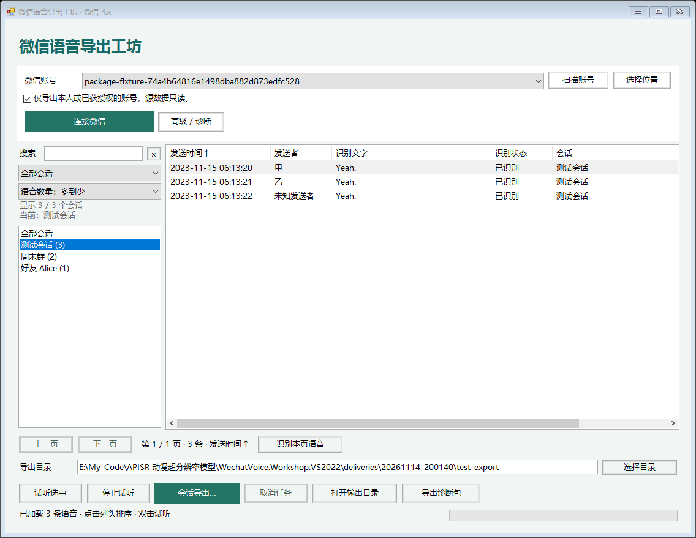

# lw.WechatVoice

[简体中文](README.md) | English

**A local Windows workshop for preserving WeChat voice messages as WAV files.**

C# / .NET Framework 4.8, native SILK decoding, and optional offline SenseVoice transcription. Browse conversations, filter dates, preview audio and export batches with searchable filenames and CSV manifests. No Python, GPU or cloud API is required to run the packaged application.

Source preparation version: **1.1.1**, adding favorite voice export. Published stable release: **1.0.0**. Windows 10/11 x64. WeChat 4.x processes may be attempted after explicit user consent, but this is **not a claim of universal 4.x compatibility**. Current real-account verification remains pending.



The screenshot contains synthetic conversations and test audio only.

## Usage

The new **收藏语音** entry reads standalone and nested favorite voices into a separate snapshot session. Existing date filters, preview, WAV export and offline naming remain available. Only content-matched local files or unambiguous original-message audio are used; missing audio is reported. Conversion currently supports SILK, with originals retained on unsupported formats. See [favorites documentation](docs/favorites.md).

1. Extract the entire Windows deployment ZIP into a writable directory.
2. Launch `WechatVoice.Workshop.exe`; .NET Framework 4.8 is required.
3. Select an account you own or are authorized to access, confirm consent and connect while WeChat is logged in.
4. Select a conversation, date range and export directory. WAV filenames follow `time_unique-id_transcript-summary.wav`.

Only locally available messages can be exported. Cleared media and official mobile backup archives cannot be recovered by this tool. Sources are accessed read-only; private snapshots, indexes and exports are written separately. The tool does not inject into or modify WeChat. Reads still consume CPU and disk resources.

## Build

Install Visual Studio 2022 with C++ x64 tools, .NET desktop development and the .NET Framework 4.8 developer pack, plus Python 3.12 x64 for reference tests.

```powershell
python tools/restore-dependencies.py
powershell -NoProfile -ExecutionPolicy Bypass -File tools/build.ps1 -SkipWorker
# Full regression, packaging, checksums and archive verification:
powershell -NoProfile -ExecutionPolicy Bypass -File tools/build-release.ps1
```

The restore script verifies pinned hashes. Small native runtime files and SILK sources are vendored; the 239 MB model is downloaded from its public host. Full release and offline-source packages retain the model and DirectML. Current transcription uses CPU, not the DirectML GPU provider.

Download from [GitHub Releases](https://github.com/lxw112190/lw.WechatVoice/releases). CI builds artifacts on pushes/PRs. Only a pushed `v*` tag matching `VERSION` publishes a GitHub Release; preview tags create prereleases.

See [build documentation](docs/build.md), [architecture](docs/architecture.md), [contributing](CONTRIBUTING.md), [changelog](CHANGELOG.md) and [third-party notices](THIRD-PARTY-NOTICES.md). These detailed documents are currently in Chinese.

## License

Original project code: [MIT](LICENSE). Third-party components and models retain their own licenses in `licenses/`. Format references and attribution are listed separately. Never submit real account databases, keys, memory dumps or private recordings in issues or pull requests. This project is not affiliated with WeChat.
