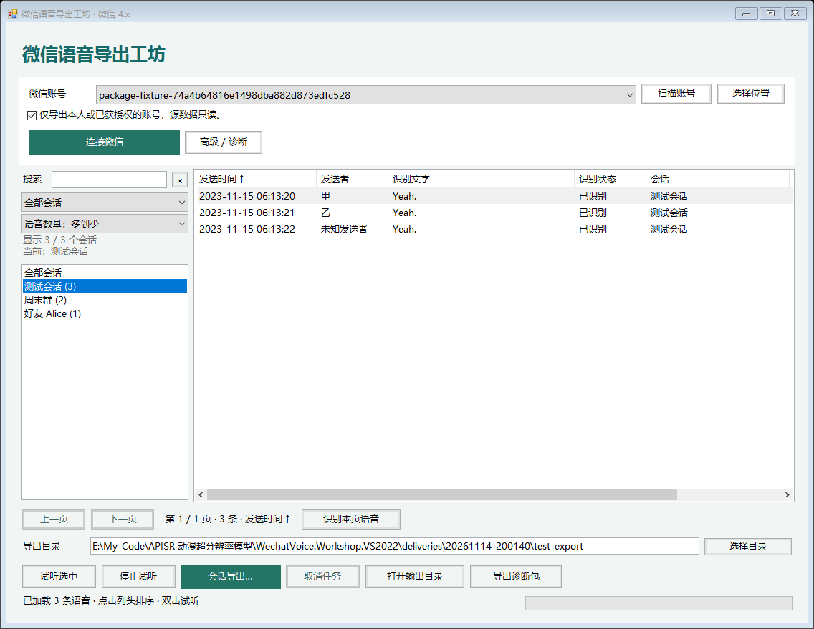

# lw.WechatVoice

简体中文 | [English](README.en.md)

**微信语音导出工坊：把珍贵的声音，保存成可以随时播放的 WAV。**

Windows x64 桌面工具，使用 **C# / .NET Framework 4.8 + 原生 SILK 解码 + 本地 SenseVoice 识别**。按会话、日期筛选电脑本地已有的语音，试听、批量导出，并用识别文字命名。不需要 Python、云端接口或 GPU。

当前源码准备版本 **1.1.1**，新增收藏语音导出；已发布正式版为 **1.0.0**。面向 Windows 微信 4.x 按实际数据验证尝试连接，**不承诺所有 4.x 均兼容**；当前 C# 引擎与有效页修复已通过合成回归，仍待真实账号复测。早期引擎的 4.0.5.16 / 4.1.0.30 授权验证不能当作当前版本验收。

[下载正式发布包](https://github.com/lxw112190/lw.WechatVoice/releases) · [CI 构建产物](https://github.com/lxw112190/lw.WechatVoice/actions)。普通推送编译打包；推送匹配 `VERSION` 的 `v*` 标签才发布 Release。

## 可以做什么

- **账号扫描与连接**：按微信自身配置扫描账号，也可手动选择目录；经用户确认后只读处理选定来源。
- **会话整理**：搜索、类型筛选、名称/时间/数量排序，独立保留当前会话。
- **语音浏览**：日期筛选、分页、列头全量排序、双击试听、右键导出选中项。
- **批量导出**：输出 WAV，可保留原始 SILK；生成 CSV / NDJSON 清单，取消保留已完成文件。
- **收藏语音**：点击“收藏语音”，读取单独收藏和聊天记录/笔记收藏中的语音；按收藏标题搜索、收藏时间筛选，复用试听、选中/批量导出和识别命名。先在微信打开收藏并下载附件，再重新读取。MD5 按文件实际内容核对，消息 ID 回退必须匹配唯一内容；缺失项明确提示并计为导出失败。当前可转换本工具支持的 SILK，其他音频格式保留原件并报告转换失败。详见 [收藏说明](docs/favorites.md)。
- **本地识别**：识别本页语音，翻页缓存保留；导出命名为 `时间_唯一编号_识别文字摘要.wav`，全文写清单。
- **问题诊断**：阶段、请求编号、错误码和耗时，白名单诊断 ZIP，不打包账号数据库与语音。



界面截图使用自动回归生成的合成账号和测试语音，不包含真实聊天。

## 快速使用

1. 下载完整 Windows ZIP，**完整解压**到可写目录。不要只复制 EXE。
2. 双击 `WechatVoice.Workshop.exe`。需要 Windows 10/11 x64 和 .NET Framework 4.8。
3. 保持本人或已获授权的微信账号登录，选择对应账号并确认授权，点“连接微信”。
4. 左侧选会话，打开“会话导出”，设置日期、输出位置和识别选项，开始导出。
5. 找不到密钥或副本校验失败时，展开“高级 / 诊断”查看原因并导出诊断包。

目录可选择单个账号文件夹、其 `db_storage`，或账号的父目录 `xwechat_files`。这里只能导出电脑实际已有的语音；不能恢复本机已清理的内容，也不能直接解析手机官方备份包。已有同结构的解密 SQLite 副本可单独导入。

WAV 示例：`20261107-143520_0123456789abcdef01234567_今天一起出去走走.wav`。识别失败不影响已成功导出的 WAV，文字摘要最多 40 字。

## 数据与兼容范围

原库、WAL 和微信进程只读访问；不注入、不修改微信、不强制关闭进程。所有解密、索引及导出写入自己的 `workspace` 或用户指定目录。读取仍会占用 CPU 和磁盘；各库分别快照，不承诺跨库同一时刻。

认证失败、WAL 校验失败或 SQLite 完整性失败不会静默跳过。连接成功、合成测试通过和真实账号兼容是三件不同的事。请先用少量语音验证；重要内容保留独立备份。

本地识别采用 CPU 路线，DirectML DLL 保留用于满足既有运行库依赖，**不代表当前启用 GPU 识别**。完整部署包仍包含模型和 DirectML；普通源码 Git 树不包含模型、真实账号、密钥或运行缓存。

## 从源码构建

安装 VS2022（C++ x64 工具链、.NET 桌面开发及 .NET Framework 4.8 开发包）与 **Python 3.12 x64**。Python 仅用于构建期参考回归。

```powershell
python tools/restore-dependencies.py
powershell -NoProfile -ExecutionPolicy Bypass -File tools/build.ps1 -SkipWorker
```

恢复脚本从公开来源下载固定 SenseVoice 模型与 Python 测试依赖，验证大小和 SHA256；不依赖小芽项目目录。SILK SDK 源码及固定 ASR DLL 保存在 `third_party/`，各文件许可见 `licenses/`。

完整构建、测试和打包：

```powershell
powershell -NoProfile -ExecutionPolicy Bypass -File tools/build-release.ps1
```

输出到 `deliveries/时间戳/`：Windows 完整包、离线源码包及 ZIP 的 SHA256。GitHub 自带 Source code ZIP 是裸源码，首次构建需要恢复依赖；Release 中的离线源码包附带模型和原生资源。详见 [构建说明](docs/build.md)。

## 目录结构

```text
src/WechatVoice.Workshop/  WinForms 界面与诊断
src/VoiceEngine/           C# 快照、索引、解码与导出引擎
src/AsrWorker/             独立本地识别进程
worker/                   Python 参考实现与回退构建材料
third_party/              固定原生源码与可再分发运行依赖
tests/                    合成数据库、音频和 UI 回归
tools/                    恢复、编译、验包与源码导出脚本
docs/                     使用、架构、发布与历史验证记录
licenses/                 第三方许可原文
.github/                  Windows CI、问题和 PR 模板
```

## 文档与参与

[架构](docs/architecture.md) · [常见问题](docs/faq.md) · [构建与 CI](docs/build.md) · [更新记录](CHANGELOG.md) · [参与开发](CONTRIBUTING.md) · [隐私问题反馈](SECURITY.md) · [历史开发记录](docs/preview-history.md)

反馈请提供工具版本、Windows 版本、微信完整版本、操作步骤、诊断代码与请求编号。不要提交真实数据库、密钥、语音或完整本机路径。

## 许可与致谢

项目自有代码采用 [MIT License](LICENSE)。第三方组件、模型及格式参考保持各自条款，详见 [THIRD-PARTY-NOTICES.md](THIRD-PARTY-NOTICES.md) 与 `licenses/`；MIT 不覆盖这些第三方材料。

感谢 ChatTrace、Moect、SILK SDK、sherpa-onnx、SenseVoice、ONNX Runtime 等项目提供的格式参考、模型与底层能力。当前工具不是微信官方产品，与微信官方无关联。

## 联系与支持

- 作者：天天代码码天天
- QQ：819069052
- QQ Group: 天天代码码天天 | 群号: 264292622

如果项目对你有帮助，可以扫码支持维护：


