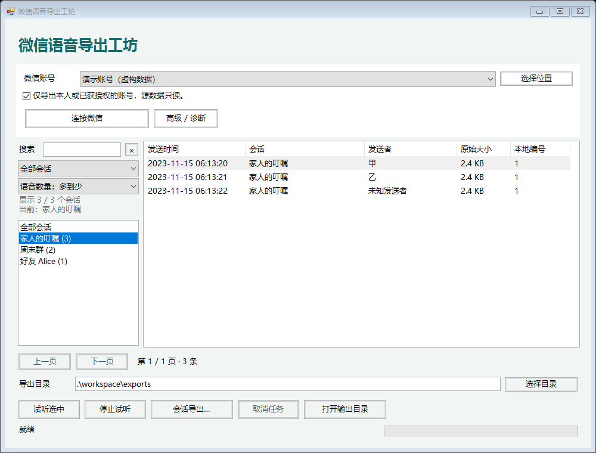
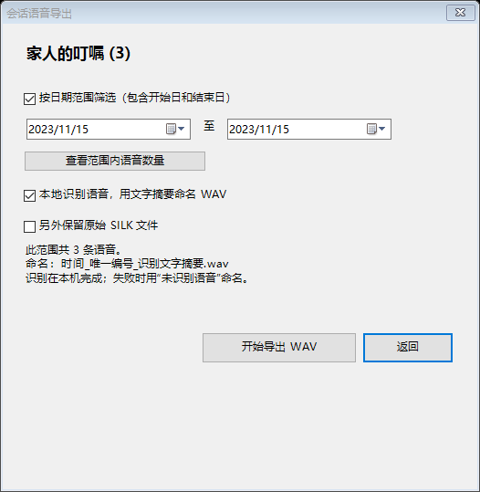

# 照片和视频之外，微信里的声音也值得好好保存

手机里的照片，记录着生活的样子；一段段视频，留住了那些热闹的瞬间。

而声音，保存着另一种记忆。

可能是父母发来的一句“记得吃饭”，是孩子第一次完整地讲一个故事，是朋友熟悉的笑声，也可能是爱人随口说的一句“我到家了”。

当时觉得平常，过了很久再听，却格外珍贵。

照片和视频，我们通常可以保存到相册，再备份到电脑或硬盘。但微信里的语音，想单独保存下来，却没有那么方便。

聊得久了，一段声音就淹没在聊天记录里。换手机、清理空间之前，也总会惦记：这些声音，以后还能找到吗？

于是，我做了一个小工具——**微信语音导出工坊**。

它的用途很简单：**把电脑微信里已经保存的语音，整理成可以独立播放、方便备份的音频文件。**



*软件主界面。截图中的账号、联系人和记录均为虚构演示数据。*

连接电脑微信后，工具会生成并读取本地数据库副本，列出包含语音的会话。选中一个人或一个群，就可以整理想留下的声音。

会话多的时候，也不用逐个翻找。左侧可以搜索会话名称和账号，筛选单聊或群聊，还可以按最近语音时间、会话名称、语音数量排序。

比如，保存孩子某一年发来的语音，整理父母最近几个月的叮嘱，或者给一段重要的聊天留一份独立备份。

进入会话导出页面，选好起止日期，还能先查看这个范围内有多少条语音，再决定导出。



*导出页面。可按时间范围整理语音，也可选择额外保留原始 SILK 文件。*

点击“开始导出 WAV”，语音就会保存为常见的 **WAV 音频文件**，方便在电脑上播放，也方便复制到移动硬盘、家庭 NAS 或其他备份设备中。

我还加了一个自己很喜欢的功能：**用语音里的文字，给文件起名字。**

普通音频导出后，如果只有一串编号，过一段时间还是很难找。

所以，工具接入了本地语音识别，把识别到的文字整理成文件名摘要，按照下面的顺序保存：

```text
时间_唯一编号_识别文字摘要.wav
```

例如，一句“记得早点回家”，导出后的文件名可以是：

```text
20261108-093015_唯一编号_记得早点回家.wav
```

时间方便按顺序整理，编号用于区分文件，文字摘要则让我们不用逐条点开，也能大致知道里面说了什么。

**完整识别文字还会写入导出清单**，后续查找和整理也更方便。

当然，识别也可能听错。遇到方言、背景噪声，或者没有识别出文字时，工具仍会保留正常导出的 WAV，用“未识别语音”作为摘要。

文字是查找线索，真正值得保存的，始终是原来的声音。

整个识别过程在本机完成。部署包已经包含模型和运行库，不需要另外配置大模型接口，也不需要把语音上传到云端进行识别。

为了让操作尽量简单，主界面只保留了账号选择、连接微信、会话列表、试听和导出等常用功能。进程选择和详细日志放进了“高级 / 诊断”，需要时再展开。

实际使用，可以按这几步操作：

1. 在 Windows 电脑上完整解压工具，打开并登录电脑微信。
2. 选择数据位置和本人账号，点击“连接微信”。
3. 搜索并选择一个会话，进入导出页面，设置需要保存的日期范围。
4. 按需勾选本地识别命名，点击“开始导出 WAV”，完成后打开输出目录。

目前，工具已经在一个获授权的真实账号上完成连接和读取测试，并抽取少量语音，验证了 WAV 导出、离线识别和文件命名流程。

它能整理的是**电脑本地实际保存的语音**，不能恢复已经清理掉的内容，也不代表一定包含全部历史聊天。使用时，请仅处理本人或已获授权的账号，妥善保管导出的声音和识别清单。

做这个工具，最初只是想解决一个小问题：微信里的语音，也应该能像照片和视频一样，方便地留下来。

后来越做越觉得，这些不起眼的语音消息，其实也是生活的记录。

文字记得住说了什么，声音还记得当时的语气、停顿和笑意。

希望这个小工具，能帮你把那些值得珍藏的声音，好好保存下来。
